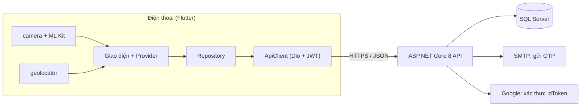
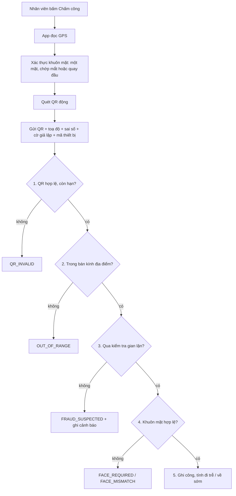
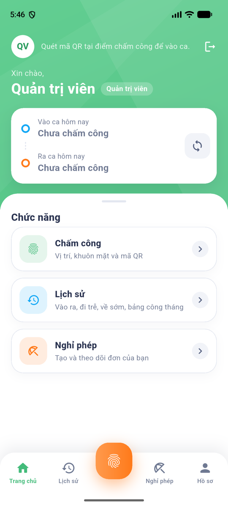
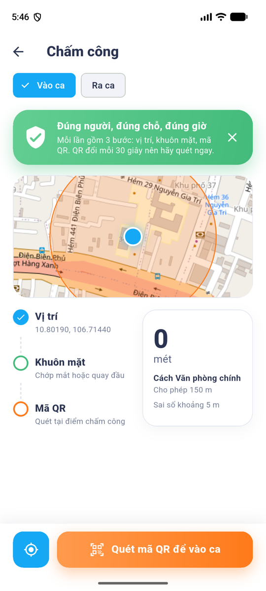

# SmartCheck – Chấm công nhân viên bằng QR động, vị trí và khuôn mặt

Bài kiểm tra giữa kì môn **Lập trình thiết bị di động** (Đề 2) – **Phạm Minh Vũ**, lớp **23DTHE1**.

Nhân viên mở app, hệ thống kiểm tra **họ đang ở đúng chỗ** (GPS), **là người thật** (chớp mắt / quay đầu) và **đang đứng trước điểm chấm công** (quét QR đổi liên tục), rồi mới ghi công. Quản lý theo dõi bảng công, bản đồ và các cảnh báo gian lận ngay trên app.

| Thư mục | Nội dung | Tài liệu |
|---|---|---|
| [`23dthe1_pham_minh_vu/`](smartcheck/23dthe1_pham_minh_vu) | App **Flutter** (Android là nền tảng chính) | [README app](smartcheck/23dthe1_pham_minh_vu/README.md) · [Kịch bản demo](smartcheck/23dthe1_pham_minh_vu/DEMO.md) |
| [`23DTHE1_pham_minh_vu 2/`](smartcheck/23DTHE1_pham_minh_vu%202) | **API ASP.NET Core 8** + SQL Server | [README backend](smartcheck/23DTHE1_pham_minh_vu%202/README.md) |

API đã deploy (app dùng sẵn địa chỉ này, không cần chạy server): <https://vupham309-001-site1.etempurl.com> · Swagger: [`/swagger`](https://vupham309-001-site1.etempurl.com/swagger). Host miễn phí "ngủ" khi nhàn rỗi nên request đầu có thể chậm 10–30 giây.

## Chức năng

**Ba chức năng đã chọn:** (e) quét **QR động**, (b) chia sẻ **vị trí**, (a) **khuôn mặt**. **Tính năng mới:** **chống fake GPS**.

- **Đăng nhập 2 bước:** mật khẩu rồi mã OTP gửi qua email (hạn 5 phút, tối đa 5 lần thử); đăng nhập **Google OAuth**; **đăng ký có xác minh email** (nhập mã gửi về hộp thư mới hoàn tất); **quên mật khẩu** (nhận mã qua email rồi đặt mật khẩu mới). Phân quyền **Admin / Manager / Employee**.
- **CRUD 4 bảng:** nhân viên, phòng ban, ca làm việc và địa điểm (chọn toạ độ trên bản đồ), đơn nghỉ phép (tạo, duyệt, từ chối).
- **Chấm công:** QR đổi mỗi 30 s, quét bằng camera, kiểm tra vị trí và khuôn mặt, tính đi trễ / về sớm.
- **Báo cáo:** lịch sử và bảng công tháng, bảng công theo ngày và theo nhân viên, bản đồ chấm công (OpenStreetMap), danh sách cảnh báo gian lận, đặt lại thiết bị.

| Role | Dùng được |
|---|---|
| **Employee** | Chấm công, lịch sử và bảng công của mình, đơn nghỉ phép |
| **Manager** | Hiện QR điểm chấm công, bảng công, duyệt nghỉ phép, bản đồ, cảnh báo gian lận |
| **Admin** | Tất cả của Manager, cộng quản lý nhân viên, phòng ban, ca, địa điểm, đặt lại thiết bị |

## Cách hoạt động



**Nguyên tắc:** app chỉ **thu thập và hiển thị**; mọi quyết định về QR, vị trí, gian lận do **server** làm, vì app chạy trên máy người dùng nên không đáng tin.

Một lần chấm công đi qua các bước sau. Server kiểm tra tuần tự và dừng ở lỗi đầu tiên:



**Chống fake GPS** (server chặn và ghi vào bảng cảnh báo cho Admin/Manager):

| Dấu hiệu | Xử lý |
|---|---|
| Hệ điều hành báo vị trí giả lập (`isMocked`) | Chặn |
| Độ chính xác GPS bằng 0 hoặc > 100 m | Chặn |
| Tài khoản chấm công từ máy khác máy đã gắn | Chặn (Admin có nút đặt lại thiết bị) |
| Di chuyển > 60 m/s so với lần chấm công trước | Chặn |
| Trùng toạ độ y hệt người khác trong 2 phút | Gắn cờ, vẫn ghi công |

## API chính

| Nhóm | Endpoint |
|---|---|
| Xác thực | `POST /api/auth/login` → `verify-otp` · `register` · `resend-otp` · `google-login` · `GET /api/auth/me` |
| CRUD | `/api/departments` · `/api/shifts` · `/api/locations` (đọc: đã đăng nhập, ghi: Admin) · `/api/employees` · `/api/leaves` |
| QR | `GET /api/qr/current?locationId=` (Admin/Manager) |
| Chấm công | `POST /api/attendance/check-in` · `check-out` · `GET /api/attendance/my` · `GET /api/attendance` · `GET /api/attendance/report` |
| Gian lận | `GET /api/fraud-alerts` · `POST /api/fraud-alerts/{id}/resolve` |

Danh sách đầy đủ và thử trực tiếp trên [Swagger](https://vupham309-001-site1.etempurl.com/swagger).

## Công nghệ

- **App:** Flutter (Dart 3.11), `provider`, `dio`, `flutter_secure_storage`, `camera`, `google_mlkit_barcode_scanning`, `google_mlkit_face_detection`, `geolocator`, `flutter_map`, `qr_flutter`, `google_sign_in`.
- **Backend:** ASP.NET Core 8, Entity Framework Core + SQL Server, ASP.NET Identity, JWT, MailKit (OTP qua SMTP), Google.Apis.Auth, Swagger. Deploy trên SmarterASP.NET.

## Chạy thử

**Chỉ chạy app** (dùng API đã deploy):
```bash
cd smartcheck/23dthe1_pham_minh_vu
flutter pub get
flutter run
```
Hoặc cài file APK (`adb install -r <file>.apk`): xem [README app](smartcheck/23dthe1_pham_minh_vu/README.md) để biết cách build và các biến cấu hình (`--dart-define=BASE_URL=...`).

**Chạy cả backend trên máy** (cần Docker và .NET 8):
```bash
cd "smartcheck/23DTHE1_pham_minh_vu 2"
cp appsettings.example.json appsettings.json     # file thật không nằm trong git
docker compose up -d                             # SQL Server 2022
dotnet run                                       # tự tạo DB, seed, mở /swagger
```
Sau đó chạy app với `--dart-define=BASE_URL=http://<ip-máy>:<cổng>`.

## Ảnh chụp màn hình

| Trang chủ Nhân viên | Chấm công | Trang chủ Admin |
|---|---|---|
|  |  |  |

## Kiểm thử và tình trạng

- App có **158 test tự động** (`flutter test`, chạy với máy chủ giả, không cần mạng) và `flutter analyze` không có lỗi.
- Đã chạy trên Android emulator với API thật; một lượt chấm công thật (QR + GPS) đã ghi nhận được lên server.
- **Chưa làm:** so khớp vector khuôn mặt với khuôn mặt đã đăng ký (hiện mới có xác thực "người thật"). Đăng nhập Google chưa dùng được trên iOS (chưa có client OAuth iOS).
- Chi tiết hơn ở phần "Giới hạn đã biết" trong [README app](smartcheck/23dthe1_pham_minh_vu/README.md).

## Bảo mật

JWT lưu bằng `flutter_secure_storage`; không ghi JWT/OTP ra log. Các file cấu hình chứa mật khẩu và khoá ký (`appsettings.json`, `appsettings.Production.json`) **không nằm trong git**; chỉ có `appsettings.example.json` với giá trị mẫu.
