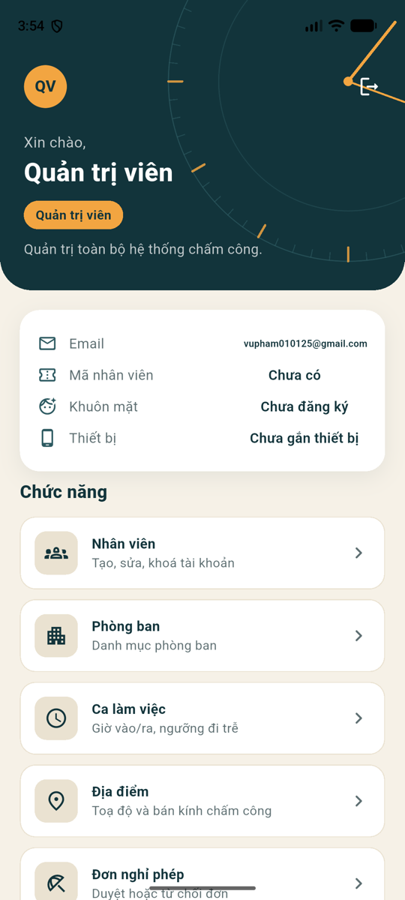
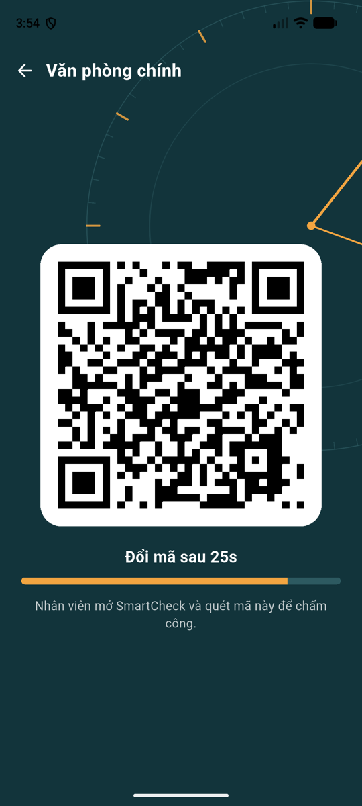
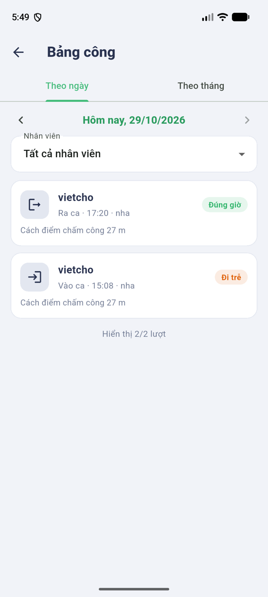
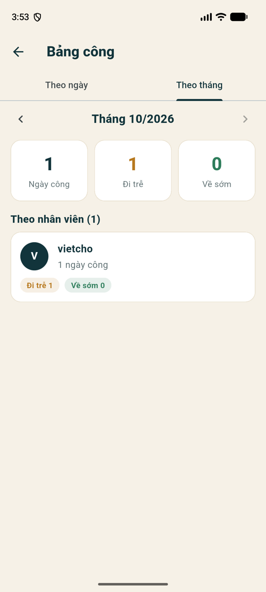
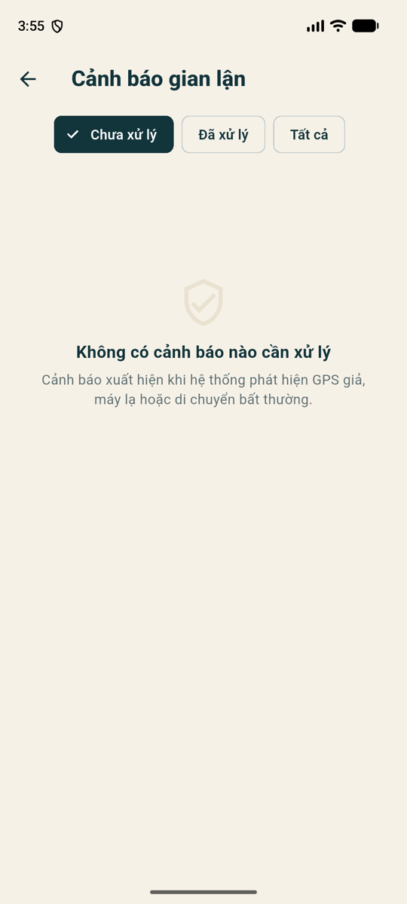
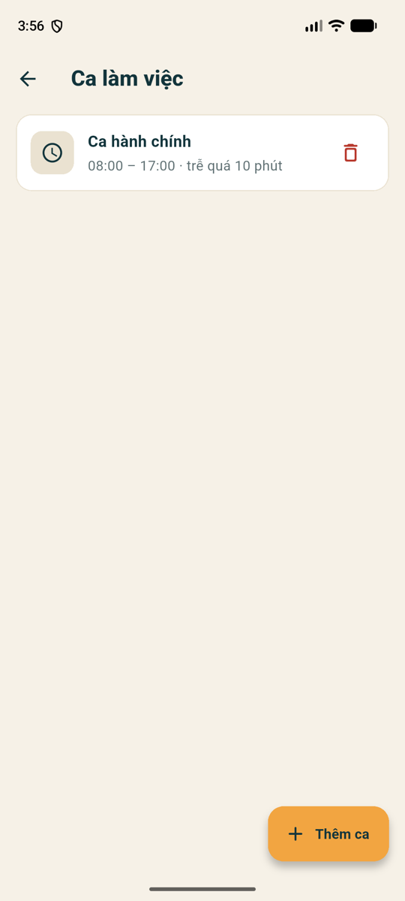
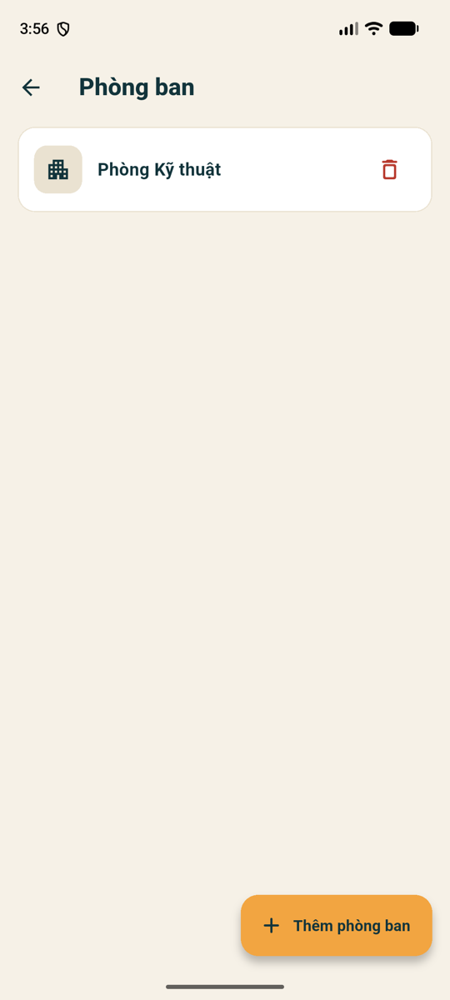

# SmartCheck – Ứng dụng chấm công nhân viên

Bài kiểm tra giữa kì môn Lập trình thiết bị di động (40%) – **Đề 2**.
Sinh viên: **Phạm Minh Vũ** · Lớp **23DTHE1** · Thư mục dự án `23dthe1_pham_minh_vu` · Package Dart `pham_minh_vu_23dthe1` · `applicationId` `com.phamminhvu.chamcong`.

App Flutter (Android là nền tảng chính) gọi API ASP.NET Core **đã deploy**; không dùng `localhost`.

## Chức năng

**Ba chức năng đã chọn**

| | Chức năng | Cách làm |
|---|---|---|
| (e) | Quét QR | Điểm chấm công (Admin/Manager) hiện **QR động** đổi mỗi 30 s (`qr_flutter`). Nhân viên quét bằng `camera` + ML Kit (`google_mlkit_barcode_scanning`) rồi gửi **nguyên chuỗi** lên server; app không tự kiểm tra QR. QR sống ~45 s nên ảnh chụp lại không dùng được. |
| (b) | Chia sẻ vị trí | `geolocator` lấy toạ độ độ chính xác cao, gửi kèm sai số, cờ giả lập và mã thiết bị. Server đối chiếu với bán kính của địa điểm. Admin/Manager xem vị trí chấm công trên bản đồ OpenStreetMap (`flutter_map`). |
| (a) | Khuôn mặt | `google_mlkit_face_detection` trên camera trước: phải có **đúng một khuôn mặt** rồi **chớp mắt hoặc quay đầu** (chọn ngẫu nhiên mỗi lần) thì mới được chấm công. *Tầng so khớp vector khuôn mặt (MobileFaceNet) chưa làm, xem phần "Giới hạn".* |

**Tính năng mới: chống fake GPS** – server từ chối khi cờ vị trí giả lập bật, độ chính xác bằng 0 hoặc > 100 m, máy lạ (mỗi tài khoản gắn với một thiết bị), hoặc di chuyển nhanh phi thực tế. Mọi vi phạm ghi vào bảng cảnh báo để Admin/Manager xử lý.

**Các phần còn lại của đề**
- Đăng ký, đăng nhập **2 bước** (mật khẩu → mã OTP gửi qua email, hạn 5 phút, tối đa 5 lần thử), đăng nhập **Google (OAuth)**. Điều hướng theo role: Admin / Manager / Employee. Phiên đăng nhập được giữ khi mở lại app (JWT lưu bằng `flutter_secure_storage`).
- **CRUD 4 bảng** (có tìm kiếm, phân trang, validate, hỏi xác nhận khi xoá, xử lý lỗi 409): Nhân viên, Phòng ban, Ca làm việc + Địa điểm (chọn toạ độ trên bản đồ, bán kính), Đơn nghỉ phép (nhân viên tạo/sửa/huỷ, Admin/Manager duyệt).
- Lịch sử chấm công, bảng công tháng, đi trễ/về sớm; bảng công theo ngày/nhân viên cho Admin/Manager; nút **Đặt lại thiết bị**.
- Màn **Cảnh báo gian lận** và **bản đồ chấm công** cho Admin/Manager.

## Ảnh chụp màn hình

Chụp từ máy ảo Android với API thật (đã lược các màn có địa chỉ cá nhân và khuôn mặt).

| Trang chủ Admin | QR động | Bảng công theo ngày |
|---|---|---|
|  |  |  |

| Bảng công theo tháng | Cảnh báo gian lận | Ca làm việc | Phòng ban |
|---|---|---|---|
|  |  |  |  |

## Cấu hình và cách chạy

Mọi cấu hình nằm ở [lib/core/config.dart](lib/core/config.dart). Có thể ghi đè lúc chạy, không cần sửa code:

| Biến | Mặc định | Ý nghĩa |
|---|---|---|
| `BASE_URL` | `https://vupham309-001-site1.etempurl.com` | URL API đã deploy (https) |
| `GOOGLE_SERVER_CLIENT_ID` | client ID Web của dự án | `serverClientId` để lấy idToken cho Google |
| `GOOGLE_IOS_CLIENT_ID` | trống | chỉ cần cho iOS, xem "Giới hạn" |

**Yêu cầu:** Flutter 3.41 (Dart 3.11), Android SDK 36, máy Android 7.0 trở lên (`minSdk 24`), có camera và GPS.

```bash
cd 23dthe1_pham_minh_vu
flutter pub get
flutter run                      # chạy trên máy/emulator đang nối
flutter run --dart-define=BASE_URL=https://<url-khac>   # đổi API
```

**Cài APK có sẵn** (thư mục `dist/`, không đưa lên git vì nặng):
- `23dthe1_pham_minh_vu-universal.apk` (~100 MB) – chạy mọi máy.
- `23dthe1_pham_minh_vu-arm64.apk` (~65 MB) – điện thoại Android thông thường (arm64).

```bash
adb install -r dist/23dthe1_pham_minh_vu-arm64.apk
# hoặc tự build:
flutter build apk --release
```

Lần đầu mở app cấp quyền **Camera** và **Vị trí**. Host miễn phí "ngủ" khi nhàn rỗi nên request đầu tiên có thể chậm khoảng 10–30 giây.

## Tài khoản mẫu

Mã OTP được gửi về **email của chính tài khoản đó**. Các tài khoản mẫu dưới đây dùng địa chỉ dạng `tên+vai-trò@gmail.com` nên thư OTP đều về **hộp thư `vupham010125@gmail.com`**; cần mở hộp thư này khi đăng nhập.

| Role | Email | Mật khẩu |
|---|---|---|
| Admin | `vupham010125@gmail.com` | do tác giả cung cấp riêng (không đăng công khai) |
| Manager | `vupham010125+manager@gmail.com` | `Demo@123456` |
| Employee | `vupham010125+nv01@gmail.com` … `vupham010125+nv05@gmail.com` | `Demo@123456` |

Các tài khoản Manager/Employee và dữ liệu đi kèm (phòng ban, ca, ~3 tuần lịch sử chấm công, đơn nghỉ, cảnh báo mẫu) **chỉ có khi backend bật `Seed:Demo=true`**, xem [README backend](../23DTHE1_pham_minh_vu%202/README.md). Nhân viên mẫu có mã `DEMO-…`; lịch sử mẫu chỉ gồm các ngày đã qua nên vẫn chấm công thật được trong hôm nay.

Tài khoản đăng nhập bằng Google (khi app còn ở chế độ Testing) chỉ dành cho email đã thêm vào danh sách người dùng thử; email Google mới sẽ vào với role Employee.

Địa điểm mẫu "Văn phòng chính" có toạ độ TP.HCM (10.8019, 106.7144), bán kính 150 m. **Khi demo hãy đổi toạ độ địa điểm về nơi đang đứng** (Admin → Địa điểm → chạm bản đồ), nếu không sẽ báo ngoài phạm vi.

## Kịch bản demo

Xem [DEMO.md](DEMO.md): đăng nhập 3 role, QR động, chấm công vào/ra, ngoài phạm vi, **fake GPS bị chặn và hiện cảnh báo**, khuôn mặt, quản trị.

## Kiến trúc

```
lib/
  main.dart                      khởi tạo, Provider
  core/        config, theme, router, api_client (Dio + JWT), secure_store, widgets
  data/
    models/                      Employee, Leave, AttendanceRecord, FraudAlert, ...
    repositories/                auth, employee, department, shift, location, leave,
                                 attendance, qr, fraud
  services/    device_id, location_service (geolocator), google_auth_service
  features/
    auth/ admin/ employee/ manager_qr/ scan/ face/ map/ reports/ shared/
```

- **State:** `provider`. **HTTP:** `dio`, interceptor gắn `Authorization: Bearer`, bắt 401 để quay về đăng nhập.
- **Nguyên tắc:** server là nơi quyết định QR/vị trí/gian lận hợp lệ; app chỉ thu thập và hiển thị. Không ghi JWT/OTP ra log.
- Màn hình khoá dọc. Mọi màn có trạng thái đang tải / lỗi (kèm nút thử lại) / trống; lỗi mạng và hết thời gian chờ được dịch sang tiếng Việt.

## Kiểm thử

```bash
flutter analyze
flutter test
```

Bộ test (widget test dùng máy chủ giả, không cần mạng) gồm: đăng nhập 2 bước và API client, CRUD 4 bảng, QR động và luồng chấm công, mọi mã lỗi của server, GPS và cờ giả lập, bản đồ và cảnh báo, lịch sử và bảng công, máy trạng thái xác thực khuôn mặt (chớp mắt/quay đầu, ảnh tĩnh không qua).

Đã thử trên: Android emulator (Android 17) với API thật và một iPhone 13 Pro Max. Phần chưa thử đủ được nêu ở dưới.

## Giới hạn đã biết

- **Khuôn mặt:** mới có xác thực "người thật" (tầng 1). Chưa so khớp vector khuôn mặt với khuôn mặt đã đăng ký (tầng 2) vì chưa có model MobileFaceNet và thông số chuẩn hoá.
- **iOS:** chạy được nhưng đăng nhập Google chưa dùng được (chưa tạo client OAuth iOS); app báo rõ thay vì lỗi. iOS không có "mock location" nên cờ giả lập không có tác dụng ở đó. Android là nền tảng chính.
- `minSdk` là 24 (không phải 23) vì thư viện camera yêu cầu.
- APK release đang ký bằng khoá debug, đủ để cài thử/nộp bài.
- Chống fake GPS dựa vào cờ do hệ điều hành báo; máy đã root có thể qua mặt, đây là giới hạn chung của cách làm này.
